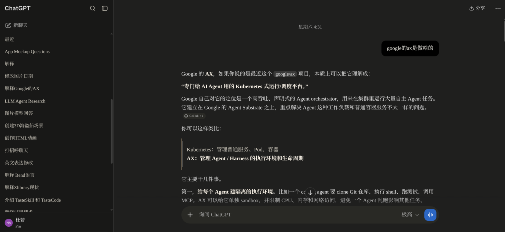

# ChatGPT UI Scripts

个人自用的 ChatGPT 网页增强脚本集合，作者：duro。

中文 | [English](README_en.md)

## 预览

这个仓库主要包含三类增强：

| 文件 | 类型 | 用途 |
| --- | --- | --- |
| `GPT Claude-like Style.user.css` | Stylus/UserStyle | ChatGPT 深色界面样式，让页面更接近 Claude 的窄版、暖灰、低干扰阅读体验。兼容 `html.dark`、`data-color-scheme`、`data-theme` 三套前端标记。 |
| `chatgpt-claude-like-separator.user.js` | Tampermonkey userscript | 配合上面的样式使用，识别纯文本分隔符段落并添加 class，方便样式渲染为更自然的分割线。 |

仓库里也包含以下附加脚本：

| 文件 | 类型 | 用途 |
| --- | --- | --- |
| `chatgpt-project-source-preview.user.js` | Tampermonkey userscript | 在 ChatGPT 项目源里预览 `.md` / `.txt` 文件，避免点击后直接下载。 |
| `chatgpt-conversation-rail.user.js` | Tampermonkey userscript | 右侧短横线对话导航，支持预览、高亮、跳转和按需补全长对话索引。 |

## 安装

### Stylus 样式

推荐方式（可从 GitHub 自动更新）：

1. 安装浏览器扩展 Stylus。
2. 打开原始文件地址：`https://raw.githubusercontent.com/Duro02/chatgpt-ui-scripts/main/GPT%20Claude-like%20Style.user.css`
3. Stylus 会弹出安装页，点击安装即可；以后在管理页对该样式点“检查更新”即可同步最新版本。

手动方式：

1. 安装浏览器扩展 Stylus。
2. 新建样式。
3. 粘贴 `GPT Claude-like Style.user.css` 的内容。
4. 打开 `https://chatgpt.com/`。

### Tampermonkey 脚本

1. 安装浏览器扩展 Tampermonkey。
2. 新建脚本。
3. 分别粘贴需要使用的 `.user.js` 文件内容。
4. 保存后刷新 ChatGPT 页面。

建议组合：

- 只想改外观：安装 `GPT Claude-like Style.user.css`。
- 想让外观里的分隔线更稳定：再安装 `chatgpt-claude-like-separator.user.js`。
- 想预览项目源 Markdown/text 文件：安装 `chatgpt-project-source-preview.user.js`。
- 想恢复右侧对话导航：安装 `chatgpt-conversation-rail.user.js`，可以单独使用。

## 主要功能

### ChatGPT Claude-like Style

- 暖灰深色主题。
- 更窄的正文阅读宽度。
- 更接近 Claude 的文本、代码块、引用块和分隔线视觉。
- 尽量不破坏 ChatGPT 原始布局节点，方便与其他脚本共存。

### ChatGPT Claude-like Separators

- 扫描 ChatGPT 回答中的纯文本分隔符段落。
- 给匹配段落添加 `claude-like-separator` class。
- 由 Stylus 样式负责最终视觉渲染。

### ChatGPT Conversation Rail

新的独立导航脚本，视觉参考 DSH 的 `TurnNavigator`：右侧固定间距的短横线，当前轮变长、变亮，悬停或键盘聚焦显示提问与回答摘要。它不需要主题样式，也不包含旧版的备份和 Prompt 管理功能。

- 点击横线跳到该轮；上下方向键、Home、End 选择节点，Enter 激活。
- 尚有未发现的历史时，横线列表最顶端显示一条红线，悬停提示“点击加载过去的对话”。点击红线加载历史并补全索引；历史索引完整后自动隐藏红线。扫描会临时滚动，结束后恢复阅读位置；再次点击、Esc、鼠标滚轮或触摸可以中止。扫描期间请保持该标签页可见。
- 加载过程中按会话 ID 保留索引，项目地址前缀变化和内容容器重新挂载不会丢失已发现节点。
- 默认只索引已挂载、已访问的节点，不自动打断阅读。缓存仅保存在当前页面内存中，刷新页面后需要重新发现或补全。
- 完整扫描结束会清除当前分支中未再出现的旧节点；编辑或切换分支后可再次补全。
- 适配新版 `data-turn-key` 和旧版 `conversation-turn-*` 节点，支持 `column-reverse` 容器的负 `scrollTop`。

性能设计：无定时轮询；滚动只读取滚动位置，用缓存坐标二分查询，并更新前后两个高亮。监听消息列表和祖先的直接结构变动，不持续监听回答内部文本；尺寸变化以 180ms 合并更新。摘要限制长度和遍历节点数；横线列表只渲染视口附近约 50 个按钮。完整历史扫描与点击后的定位校准有次数和时间上限。

脚本只读取页面 DOM，不请求会话 API，不发送内容，不使用本地持久化存储。历史高度重新估计时，未挂载节点的位置可能暂时不精确；跳转后会尝试校准，必要时重新补全。

开发验证：运行 `node tests/chatgpt-conversation-rail.test.js`。在仓库根目录启动本机 HTTP 服务，打开 `tests/conversation-rail.browser.html`，点击“运行浏览器验证”。页面覆盖千轮索引、滚动/流式更新开销、新旧结构、虚拟化历史、会话切换和释放资源。

视觉参考：[DSH TurnNavigator](https://github.com/deepseek-ai/deepseek-harness/blob/main/packages/client/ui-chat/src/client/chat/TurnNavigator.tsx)。新脚本独立实现，按本仓库 MIT 许可发布。

### ChatGPT Conversation Navigator（已归档）

文件在 `archived/chatgpt-conversation-navigator.user.js`，是 YukonKong 原始 `ChatGPT体验增强插件` 的修改版，提供长对话时间线导航、Prompt 管理器、会话备份等功能。

当时因 ChatGPT 自带导航而归档。该历史版本仍**不保证可用性**，仅留档供需要时自行取用；需要轻量导航请使用上面的 Conversation Rail。

原修改版相对原脚本的改动：

- 使用 `conversation-turn-*` wrapper 作为长对话时间线锚点。
- 适配 ChatGPT 虚拟化 DOM，减少长对话跳转错位。
- 增加 Prompt 管理器，支持命名、分类、保存、追加到当前输入。
- 增加当前会话备份能力，并改进长对话滚动采集。
- 在对话列表和右侧时间线中标记分支对话，区分“编辑用户消息产生的分支”和“重新生成回答产生的分支”。
- 支持点击 `Index Missing` 补全长对话中尚未缓存的预览文本与分支标记。
- 移除原脚本 GreasyFork 自动更新地址，避免修改版被自动更新回原版。

使用方式：

- 右侧圆点时间线可快速跳转到对应用户提问。
- 点击右侧列表按钮可展开“对话列表”，按序号或文本搜索并跳转。
- 对长对话或旧对话，点击 `Index Missing` 可以让脚本滚动检查未缓存节点，补全预览文本和分支状态。
- 长按右侧时间线圆点可手动重点标记，再次长按可取消。
- 右下角 Prompt 管理按钮可保存常用 prompt，按分类管理，并追加到当前输入框末尾。
- 备份按钮可导出当前对话 Markdown；长对话会优先复用已有备份记录，只扫描未备份部分。

颜色含义：

- 灰色圆点：普通对话节点。
- 黄色圆点：手动重点标记的节点。
- 蓝色圆点 / `2/2` 蓝色标签：该用户提问存在编辑后重发产生的分支。
- 白色圆点 / `A 2/2` 白色标签：该轮 GPT 回答存在重新生成产生的回答分支。
- 黄蓝双色：既是手动重点标记，又存在用户提问分支。
- 黄白双色：既是手动重点标记，又存在回答分支。
- 蓝白双色：同一轮同时存在用户提问分支和回答分支。
- 黄蓝白三色：同一轮同时存在手动重点标记、用户提问分支和回答分支。

## 许可证与署名

- `archived/chatgpt-conversation-navigator.user.js`（已归档）基于 YukonKong 的原始脚本修改，原脚本许可证为 `CC-BY-NC-4.0`。本修改版继续保留原作者署名和同一许可证限制，仅可在许可证允许范围内使用和再发布，尤其注意非商业限制。
- `GPT Claude-like Style.user.css`、`chatgpt-claude-like-separator.user.js`、`chatgpt-project-source-preview.user.js` 由 duro 编写。除非单个文件另有说明，按 `MIT` 许可发布。

原始脚本来源：

- `ChatGPT体验增强插件` by YukonKong
- GreasyFork update URL: `https://update.greasyfork.org/scripts/570234/ChatGPT%E4%BD%93%E9%AA%8C%E5%A2%9E%E5%BC%BA%E6%8F%92%E4%BB%B6.user.js`

## 注意

ChatGPT 网页 DOM 变化很快，这些脚本都依赖当前网页结构。若某个功能突然失效，通常需要用浏览器开发者工具重新确认相关 DOM 或请求路径。
